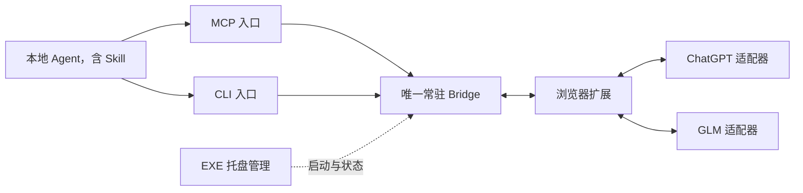

# AI-Web-MCP

版本 **1.1.0**。把已登录的 ChatGPT 与智谱清言 GLM 网页接给本地 Agent，支持文本沟通、历史会话续聊、图片理解，以及先上传后提问的组合操作。

## 四种能力，共用一座桥

| 提供方 | 文本 | 图片 |
|---|---|---|
| ChatGPT (`chatgpt`) | 问答、规划、旧聊天续聊 | 识字、截图与布局理解 |
| 智谱清言 (`glm`) | 问答、规划、新建或指定旧聊天 | 自定义问题，或“这是什么”图片动作 |



MCP 和 CLI 是同一服务的两个入口，Skill 属于 Agent 的本地操作规范。EXE 管理 Bridge 生命周期，不运行模型。文本与图片均由浏览器当前网页处理，不需要官方 API Key，也不自动切换到付费 API。

## 安装

Windows 需要 Python 3.11+、Edge/Chrome 和已经可用的网页登录会话。在仓库根目录运行：

```powershell
python -m venv runtime/venv
& ./runtime/venv/Scripts/python.exe -m pip install -r requirements.txt
& ./runtime/venv/Scripts/python.exe scripts/setup_local.py
& ./scripts/start_bridge.ps1
```

在 `edge://extensions` 或 `chrome://extensions` 开启开发者模式，加载 `extension` 目录。支持网页域名为 `chatgpt.com`、`chat.openai.com`、`chatglm.cn`；打开或刷新要使用的网页。现有扩展更新后需确认新增站点权限并重载。

从源码构建托盘程序需 MinGW-w64 `g++` 和 `windres` 在 PATH：

```powershell
& ./scripts/build_exe.cmd
& ./scripts/create_shortcut.ps1
```

双击 **AI Web MCP** 桌面快捷方式启动服务。关窗口隐藏到托盘，托盘退出停止桥。日常无须同时手动运行命令行。

## Agent 使用

MCP stdio 使用项目 venv 的 `python.exe`，参数为 `-m ai_web_mcp.mcp_server`；`PYTHONPATH` 指向项目 `src` 绝对路径，工具超时建议 660 秒。

先 `list_ai_providers`、`list_ai_tabs`，再选提供方和目标：

```text
open_ai_chat(provider="glm", url="https://chatglm.cn/main/alltoolsdetail?cid=CONVERSATION_ID&lang=zh")
ask_ai(question="继续之前的规划", target_id="返回的目标")
```

新聊天使用 `open_ai_chat(provider="glm", new_chat=true)`；ChatGPT 同样适用，把提供方换成 `chatgpt`。不指定提供方且有多个候选时，必须明确目标。

图片有两种用法：

```text
# 一次上传并提问
ask_ai_image(image_path="本地图片绝对路径", question="提取全部文字", target_id="目标", request_id="本次图片任务ID")

# 或拆开：先上传，不发送
upload_ai_image(image_path="本地图片绝对路径", target_id="目标", request_id="上传任务ID")
# 再提问并使用已有附件
send_ai_message(content="分析图中的布局", target_id="目标", use_attachments=true, request_id="发送任务ID")
```

GLM 可使用默认“这是什么”图片问题，也能指定识字、翻译等问题。上传成功不代表问题已发送。超时先用原 ID 查询 `chat_task_status`，不换 ID 自动重发。

## CLI 与 Skill

统一 CLI：`python scripts/ai_web.py --help`。提供方、目标和请求 ID 与 MCP 使用相同规则；doctor、providers、tabs、open、ask、vision、upload、send、task、cancel 等命令均输出 JSON。

将 `skill/ai-web-mcp` 放入本地 Agent 技能目录，设置 `AI_WEB_MCP_ROOT` 为安装目录。Skill 覆盖四种能力、会话选择、分步上传和恢复规则。旧 GPT 工具与入口保留为兼容接口。

## 维护

普通交付运行 `python scripts/bump_version.py minor`（1.0.0 → 1.1.0）；临时小补丁使用 `patch`（1.1.0 → 1.1.1）。一批交付统一升版一次。`--check` 检查版本一致。

`python scripts/clean_workspace.py` 预览缓存清理，`--apply` 执行。保留登录状态、配置、聊天数据库和运行环境。公开源码不含机器 token、浏览器资料和本地聊天记录。

网页适配依赖页面结构；支持打开指定历史会话，不代表能搜索账户全部历史。图片接口当前为单张本地图片；本桥不会替 Agent 截屏或控制其他软件。

更多资料：[架构](docs/ARCHITECTURE.md)、[版本记录](docs/RELEASES.md)、[Skill](skill/ai-web-mcp/SKILL.md)。
