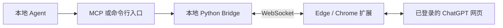

# GPT Web MCP

版本 **1.0.0**。把已登录的 Edge / Chrome ChatGPT 网页接给本地 Agent，用于规划沟通、历史会话续聊和图片识别。使用浏览器当前账户，不需要 OpenAI API Key，也没有自动 API 回退。

## 它如何工作



问题和图片沿这条链路送进网页，回答沿原路返回。真正需要持续可用的是：**ChatGPT 网页、浏览器扩展、本地 Bridge**。

| 组件 | 职责 | 何时需要 |
|---|---|---|
| 浏览器扩展 | 定位输入框、上传图片、发送问题、读取回答 | 始终需要 |
| Python Bridge | 管理标签、会话、任务队列、超时与本地记录 | 始终需要 |
| Windows EXE / 托盘 | 启动和管理 Bridge，显示连接状态 | 日常双击入口；可用 Python 启动代替 |
| MCP | 让 Agent 发现和调用 ask_chatgpt 等工具 | Agent 支持 MCP 时使用 |
| 命令行 CLI | 提供相同能力的 JSON 输入输出入口 | 没有 MCP 或调试时使用 |
| Skill | 告诉 Agent 选哪个入口、怎样续聊、怎样处理超时 | 可选的使用说明，不是另一个服务 |

MCP 和命令行是同一套服务的两个入口，选一个即可。EXE 内不包含模型；图片由网页 ChatGPT 理解。

## Windows 安装

需要 Python 3.11+、Edge 或 Chrome，以及可正常使用的 ChatGPT 登录会话。在仓库根目录运行：

```powershell
python -m venv runtime/venv
& ./runtime/venv/Scripts/python.exe -m pip install -r requirements.txt
& ./runtime/venv/Scripts/python.exe scripts/setup_local.py
& ./scripts/start_bridge.ps1
```

在 `edge://extensions` 或 `chrome://extensions` 开启开发者模式，加载本仓库的 `extension` 目录，然后打开或刷新 ChatGPT。唯一 ChatGPT 标签会自动绑定；多个标签需显式选择。

从源码构建 Windows 托盘程序需要 MinGW-w64 的 `g++`、`windres` 在 PATH：

```powershell
& ./scripts/build_exe.cmd
& ./scripts/create_shortcut.ps1
```

双击桌面快捷方式即可启动服务。关闭状态窗口会隐藏至托盘；托盘退出才会停止程序。

## 接给 Agent

MCP stdio 配置采用项目 venv 的 `python.exe`，参数为 `-m gpt_web_mcp.mcp_server`，环境变量 `PYTHONPATH` 指向仓库的 `src` 绝对路径。工具超时建议 660 秒。此写法适用于会错误拆分含空格脚本路径的客户端。

1. `browser_status()` 确认在线、页面就绪。
2. `open_chatgpt_conversation(url="https://chatgpt.com/c/CONVERSATION_ID")` 定位旧聊天，读取返回的 `target_id`。
3. `ask_chatgpt(question="继续之前的规划", target_id="返回的目标")`。
4. 图片用 `ask_chatgpt_image(image_path="本地图片绝对路径", question="识别文字和布局", target_id="返回的目标", request_id="本次唯一ID")`。

已打开的旧聊天会直接复用；没有则打开指定 URL，不创建新聊天替代。超时后查询原任务，避免重复发送。

无 MCP 时，从仓库根目录使用 CLI：

```powershell
$env:GPT_WEB_MCP_ROOT = (Get-Location).Path
& ./runtime/venv/Scripts/python.exe skill/gpt-web-mcp-workflow/scripts/ask_brain.py --url 'https://chatgpt.com/c/CONVERSATION_ID' '继续之前的规划'
& ./runtime/venv/Scripts/python.exe skill/gpt-web-vision/scripts/vision.py doctor
& ./runtime/venv/Scripts/python.exe skill/gpt-web-vision/scripts/vision.py vision --url 'https://chatgpt.com/c/CONVERSATION_ID' --image 'C:/images/example.png' --question '描述图片'
```

可将 `skill` 中的两个目录放进 Agent 的技能目录，并设置 `GPT_WEB_MCP_ROOT` 为实际安装位置。

## 维护与版本

- 本次基线为 `1.0.0`。
- 普通改动：`python scripts/bump_version.py minor`，例如 `1.0.0 → 1.1.0`。
- 临时小补丁：`python scripts/bump_version.py patch`，例如 `1.0.0 → 1.0.1`。
- 同一批交付升一次版本；改完测试、Git 提交并打 `v版本号` 标签。
- `python scripts/bump_version.py --check` 检查四处版本一致。
- `python scripts/clean_workspace.py` 预览清理，追加 `--apply` 删除可重建缓存和旧构建包。保留 Python 环境、登录状态、配置、聊天数据库与正式源文件。

公开仓库排除机器 token、生成配置、浏览器数据、SQLite 聊天记录和本机验收对话。网页改版可能需要更新扩展选择器。

更多资料：[架构与工作流](docs/ARCHITECTURE.md)、[1.0.0 发布说明](docs/RELEASES.md)、[协议](docs/PROTOCOL.md)、[技能](skill/gpt-web-mcp-workflow/SKILL.md)。
